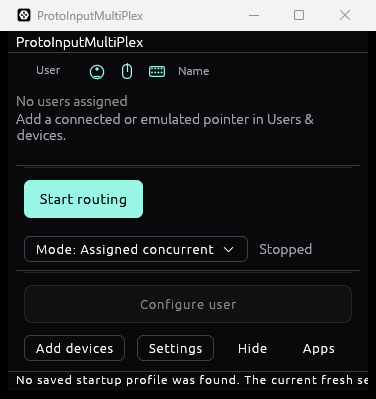

# ProtoInputMultiPlex

Give virtual users their own mouse and keyboard in separate Windows applications.

ProtoInputMultiPlex lets you create users, choose their target applications, and
send input through a desktop interface, macros, or an MCP client. For example,
two virtual users can click and type in two separate test windows at the same time.

[Download the experimental RC](https://github.com/KTheMan/ProtoInputMultiPlex/releases/tag/v0.1.0-rc.1) · [Documentation](docs/README.md) · [Report an issue](https://github.com/KTheMan/ProtoInputMultiPlex/issues)

**This is an experimental release.** The tested workflow uses virtual mouse and
keyboard pairs with controlled target applications. Physical-device compatibility
and support for other applications still need testing.

*The Home screen in the current release.*

https://github.com/user-attachments/assets/b0612af3-7fbf-4056-a4b8-8598f72d97fd

*Two virtual users controlling Mines and Fifteen concurrently through MCP.
Scripted input, played at normal speed. Live window/cursor composition:
game snapshots at about 1.9 Hz and observed cursor positions at about 30 Hz.
[Demo notes and verification](docs/media/two-games-demo.md).*

## Download and start

For **Windows x64**. Both packages use software DX12 for the main interface and
are currently **unsigned**. The SignPath signing application has been submitted;
approval is pending.

| Package | Use it for |
| --- | --- |
| [Portable EXE](https://github.com/KTheMan/ProtoInputMultiPlex/releases/download/v0.1.0-rc.1/ProtoInputMultiPlex-0.1.0-windows-x64-portable.exe) | Extract into a new folder, launch from Finish, then use `launch-gui.cmd` for later launches. Keep the extracted folder together. |
| [Installer EXE](https://github.com/KTheMan/ProtoInputMultiPlex/releases/download/v0.1.0-rc.1/ProtoInputMultiPlex-0.1.0-windows-x64-setup.exe) | Install for your Windows user and launch ProtoInputMultiPlex from the Start menu. |

[Checksums](https://github.com/KTheMan/ProtoInputMultiPlex/releases/download/v0.1.0-rc.1/SHA256SUMS.txt) and the
[qualification summary](https://github.com/KTheMan/ProtoInputMultiPlex/releases/download/v0.1.0-rc.1/qualification.json)
identify the tested packages.

For a first session, follow [two virtual users and test windows](docs/first-session.md).
It shows how to send input with Input lab and check which window receives it.
The built-in test windows need OpenGL; the guide also describes choosing your
own target applications.
The default emergency Stop shortcut is **Ctrl+Alt+Shift+F11**.

See [installation and recovery](docs/installation-recovery.md) for upgrades,
uninstalling, data locations, backups, and moving a portable folder.

## What you can do

- **Control separate applications:** give each virtual user a cursor and keyboard,
  select target processes, and choose concurrent or switched [routing](docs/concurrent-routing.md).
- **Adjust each user's input:** configure keyboard delivery, motion, button mappings,
  scrolling, and cursor appearance. See [input settings](docs/README.md#input-and-automation).
- **Automate repeated actions:** record virtual input, edit macros, or connect actions
  in [Mapper](docs/input-mapper-contract.md).
- **Connect an AI agent:** use [MCP](https://github.com/KTheMan/ProtoInputMultiPlex/blob/d38f5676b81568f024d7ea989b883cf9f407f04a/docs/agents.md)
  to control virtual users within the targets and permissions you grant.

The app also includes drawing, magnification, image matching, and local OCR.
The [documentation index](docs/README.md) links each feature's guide and test scope.

## Current limits

The portable and installed packages passed recorded tests in a Windows VM with
two virtual users, separate target windows, routing-mode changes, keyboard
suppression, Stop, and cleanup. Those tests do not establish compatibility with
every application or physical device.

Independent users need **separate target processes**. Normal desktop input stays
active. The native backend loads hooks into selected processes, and its DLLs can
remain loaded until those processes close.

Desktop-wide isolation, same-process multi-user control, and full MouseMux Ultra
parity remain open. An intermittent GUI stall and additional SDK qualification
work are also tracked in [known limits](docs/known-limitations.md).

See [reporting problems](docs/known-limitations.md#report-a-problem) and the
[validation record](https://github.com/KTheMan/ProtoInputMultiPlex/blob/d38f5676b81568f024d7ea989b883cf9f407f04a/docs/validation.md).

## Development

Development is LLM-assisted. The native hooking and injection backend
comes from [Ilyaki's ProtoInput](https://github.com/Ilyaki/ProtoInput). This project
builds on that work with a Rust application, an Ouroboros-based interface, routing
controls, and integrations. See [building and contributing](docs/development.md), the
[roadmap](docs/roadmap.md), and the [documentation index](docs/README.md).

Detailed feature milestones and test histories are preserved in the
[development-history archive](docs/history/readme-2026-11-17.md).

## License and policies

Project code is MIT-licensed. The separately licensed backend, dependencies and
OCR weights have their own notices. Development follows the
[clean-room implementation policy](docs/development.md#clean-room-implementation).

[License](LICENSE) · [Third-party notices](THIRD_PARTY_NOTICES.md) · [Privacy policy](docs/privacy.md) · [Code signing policy](docs/code-signing-policy.md)
